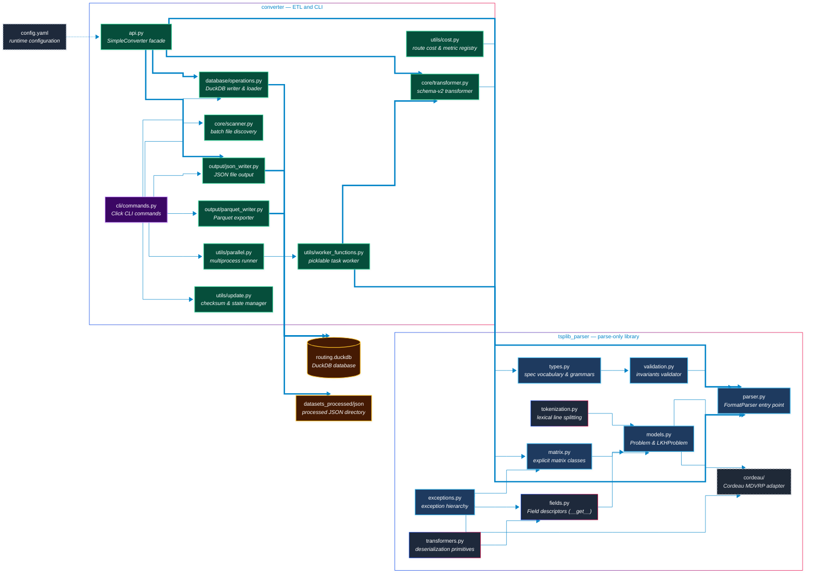
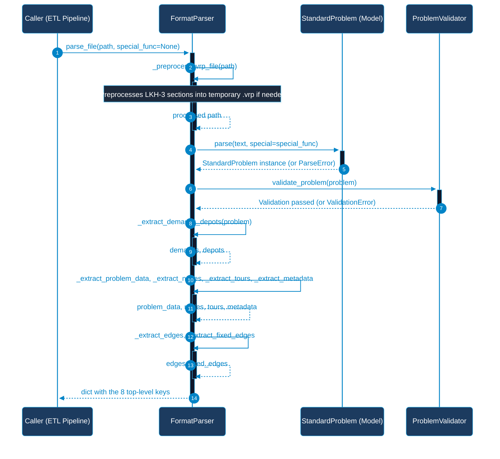
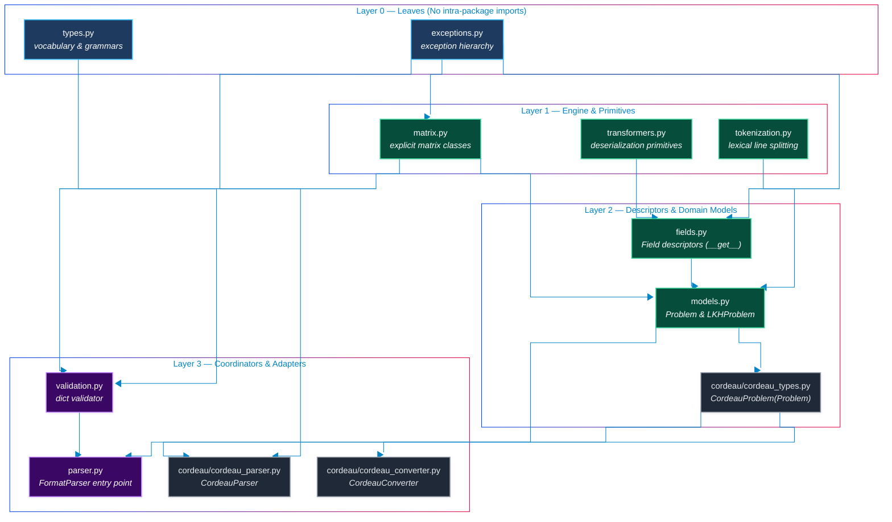

# Architecture Blueprint — TSPLIB95 Parser + ETL Converter

Scope: `src/**` only. Every non-obvious claim carries `path:line` as measured on 2026-10-15. Where the existing diagram documents disagree with the code, the code wins and the contradiction is stated.

---

## 1. Overview

`routing_data` is a **two-package python library** plus a small Click CLI. It reads TSPLIB95-format routing instances (TSP, ATSP, CVRP/VRP, HCP, SOP, TOUR) and turns them into JSON files and a DuckDB database.

| Package | Role | Size | Public entry point |
| --- | --- | --- | --- |
| `src/tsplib_parser/` | Parse-only library. Text → typed model → plain `dict`. No I/O beyond the source file. | 3.85 kLOC (12 modules) | `FormatParser.parse_file` (`src/tsplib_parser/parser.py:103`) |
| `src/converter/` | ETL. Parse → reshape → JSON / DuckDB / Parquet. Owns the CLI. | 4.29 kLOC (22 modules) | `converter` CLI (`src/converter/cli/commands.py:22`) and `src/converter/api.py` |

**The one dependency rule:** `converter → tsplib_parser`, never the reverse. No module under `src/tsplib_parser/` imports `converter` (verified by import grep). It is realised in four places: `converter/api.py:14` (`FormatParser`), `converter/core/transformer.py:11` (`matrix`), `converter/utils/cost.py:29-30` (`exceptions`, `types`), and `converter/utils/worker_functions.py:49-50` (function-local imports in the picklable worker).

**Architecture principles actually evidenced in the code:**

1. **One spec vocabulary.** `src/tsplib_parser/types.py` is the single source for problem types, the `VRP → CVRP` alias (`types.py:72`), extension hints (`types.py:84`), the `EDGE_WEIGHT_TYPE` vocabulary (`types.py:96`) and the section grammar table (`types.py:159`). Consumers read it instead of copying it: `validation.py:9,11` imports the coordinate dimensions and `VALID_PROBLEM_TYPES`; `converter/utils/cost.py:30` imports `EDGE_WEIGHT_TYPES`, so the distance registry cannot drift from the parser's legality check (`PC8`, `CV2`).
2. **No silent drops.** A section with no registered field is reported (`models.py:773`), a section whose body fails is reported (`models.py:780`), and the VRP preprocessor records every section it strips (`parser.py:20`, `:271-289`, `:365-366`). Errors are aggregated into one `ParseError` (`models.py:896-898`).
3. **Library emits records, CLI owns the run log.** Policy `P7` (`src/tsplib_parser/TODO.md` §7) is only half-implemented: `FormatParser` takes an injected logger (`parser.py:83`), but `converter/utils/logging.py:35-39` still installs a `FileHandler` when a `log_file` is passed and the CLI calls `setup_logging(level=log_level)` without one (`cli/commands.py:28`) — the run log at `log/run-<timestamp>.log` does not exist.
4. **Parse-only library vs. ETL.** The parser never computes distances: it records the declared `EDGE_WEIGHT_TYPE` and re-bases indices to 0-based; the arithmetic lives in `converter/utils/cost.py` (`P2` revised, `CV1`).

---

## 2. System context and components



| Module | Lines | Responsibility | Key symbols (line) | Depends on |
| --- | --- | --- | --- | --- |
| `tsplib_parser/types.py` | 241 | Spec vocabularies + section grammars; no I/O | `ProblemType` `:53`, `PROBLEM_TYPE_ALIASES` `:72`, `VALID_PROBLEM_TYPES` `:77`, `EXTENSION_TYPE_HINTS` `:84`, `EDGE_WEIGHT_TYPES` `:96`, `SectionGrammar` `:126`, `SECTION_GRAMMARS` `:159`, `NODE_COORD_DIMENSIONS` `:237`, `DISPLAY_DATA_DIMENSIONS` `:241` | — |
| `tsplib_parser/exceptions.py` | 129 | Exception hierarchy + context wrapping | `FormatError` `:24` (`wrap`/`amend`), `ParseError(FormatError, ValueError)` `:77`, `ValidationError` `:96`, `UnsupportedFeatureError` `:114` | — |
| `tsplib_parser/matrix.py` | 363 | EXPLICIT matrix classes + format registry | `Matrix` `:54`, `FullMatrix` `:156`, `HalfMatrix` `:170`, the 8 half-matrix variants `:223`–`:343`, `TYPES` `:353` | `exceptions` |
| `tsplib_parser/models.py` | 967 | Field-based TSPLIB95 model (utilities + transformers + fields + model in one module, `PP1`) | `BiSep` `:54`, `Transformer` `:115`, `FuncT` `:129`, `NumberT` `:152`, `EdgeDataT` `:169`, `ContainerT`/`ListT`/`MapT` `:229`/`:308`/`:318`, `Field`/`TransformerField` `:409`/`:436`, 9 concrete fields `:453`–`:551`, `FileMeta` `:597`, `Problem` `:621`, `_SectionAccumulator` `:723`, `StandardProblem` `:785` | `exceptions`, `matrix` |
| `tsplib_parser/parser.py` | 901 | ETL entry point: preprocess → parse → validate → extract | `_STRIPPED_SECTIONS` `:20`, `FormatParser` `:34`, `parse_file` `:103`, 8 `_extract_*` `:390`–`:704` | `exceptions`, `models`, `validation`, `matrix` |
| `tsplib_parser/validation.py` | 203 | Cross-field invariants over `as_name_dict()` | `validate_problem_data` `:25`, `validate_coordinates` `:167`, `FUNCTIONAL_EDGE_WEIGHT_FORMATS`, `WEIGHT_BEARING_TYPES` | `matrix`, `types` |
| `tsplib_parser/cordeau/*` | 730 | Standalone Cordeau MDVRP parser + converter to TSPLIB CVRP text; not wired into `FormatParser` (`PP6`) | `CordeauParseError` `cordeau_parser.py:13`, `CordeauParser` `:19`, `CordeauConverter.to_tsplib95` `cordeau_converter.py:46`, `CordeauProblem` `cordeau_types.py:70` | within `cordeau/` |
| `converter/api.py` | 301 | High-level API + schema-v2 payload builder | `SimpleConverter` `:22`, `merge_v2_payload` `:167`, 5 module-level functions `:215`–`:287` | `tsplib_parser.parser`, `core`, `database`, `output`, `utils.logging` |
| `converter/cli/commands.py` | 586 | Click CLI: `process`, `validate`, `analyze`, `init`, `export-parquet`, `inspect` | `cli` group `:22` | `core.scanner`, `database`, `output`, `utils.*` |
| `converter/core/scanner.py` | 172 | Glob-based discovery and batching | `FileScanner` `:12` | — |
| `converter/core/transformer.py` | 552 | Parse-result → storage shape; array-column payload; solution-file parsing | `DataTransformer` `:17`, `_convert_edge_weights_to_matrix` `:184`, `_expand_vrp_matrix` `:238`, `to_json_format` `:280`, `parse_solution_data` `:373` | `tsplib_parser.matrix` |
| `converter/database/operations.py` | 907 | DuckDB schema v2 write/read, per-type dispatch | `DatabaseManager` `:41`, `_TYPE_INSERTERS` `:245`, `_TYPE_TABLES` `:258`, `_normalize_type_for_schema` `:273` | `utils.exceptions` |
| `converter/output/json_writer.py` | 126 | One JSON file per problem, optionally by type | `JSONWriter` `:11`, `write_problem` `:44` | `core.transformer` |
| `converter/output/parquet_writer.py` | 266 | DuckDB table → Parquet export | `ParquetWriter` `:14`, `export_database_to_parquet` `:242` | `duckdb` |
| `converter/utils/cost.py` | 287 | TSPLIB distance registry + route cost | `_COORD_DISTANCES` `:132`, `supported_weight_types` `:185`, `compute_routes_cost` `:233` | `tsplib_parser.exceptions`, `tsplib_parser.types` |
| `converter/utils/parallel.py` | 272 | Process/thread pool runner with progress reporting | `ParallelProcessor` `:15`, `process_files_parallel` `:56` | `concurrent.futures` |
| `converter/utils/worker_functions.py` | 122 | Module-level picklable worker | `process_file_for_parallel` `:22`, `calculate_checksum` `:100` | `core.transformer`, `tsplib_parser.parser` |
| `converter/utils/update.py` | 273 | Incremental update / checksums | `UpdateManager` | — |
| `converter/config.py` | 68 | YAML config dataclass | `ConverterConfig` `:11`, `load_config` `:38`, `save_config` `:57` | `pyyaml` |

`config.yaml` is written by `converter init` and read only by `load_config`, which has no caller in `src/**` (`m12`); the CLI derives its DB path from `-o/--output` instead (`config.yaml`, in-file note dated 2026-08-28).

---

## 3. The parse pipeline



`parse_file` (`parser.py:103`) runs: `_preprocess_vrp_file` (`:158`, impl `:219`) → read + `StandardProblem.parse` (`:165-167`) → `validate_problem` (`:173`, impl `:822`) → extractors (`:179`–`:196`). The temp file is unlinked in `finally` (`:168-170`, `PB3` fixed). `special_func` is accepted and forwarded as `special=` (`:167`) but the model ignores `**options` (`models.py:811`), so it is dead (`PB1`).

| Extractor | Line | Reads (model attribute) | Result key | Conditional? |
| --- | --- | --- | --- | --- |
| `_extract_demands_depots` | `:587` | `demands` (dict, 1-based), `depots` (list/int) | `demands` (length-`dimension` 0-based list), `depots` (sorted 0-based) | Key always present; `[]` when the section is absent |
| `_extract_problem_data` | `:390` | `as_name_dict()` (`models.py:661`), `edge_weights` via `create_explicit_matrix()` (`models.py:904`) | `problem_data` | `edge_weights` only when truthy (`:436-441`, `:439` emits a `Matrix`); VRP keys only from preprocessing (`:444-465`) |
| `_extract_nodes` | `:506` | `node_coords`, `demands`, `depots`, `display_data` | `nodes` | `[]` when there is no `NODE_COORD_SECTION` (root of `PB13`: display data then has nowhere to go) |
| `_extract_tours` | `:626` | `tours` | `tours` (`[{tour_id, nodes}]`, 0-based, `-1` stripped) | `[]` when absent |
| `_extract_metadata` | `:704` | problem attributes, `_check_symmetry` (`:741`), `_identify_weight_source` (`:777`), `_additional_vrp_fields` | `metadata` (9 keys) | Always 9 keys |
| `_extract_edges` | `:660` | `edge_data` | `edges` (0-based `[from, to]`) | `[]` when absent |
| `_extract_fixed_edges` | `:682` | `fixed_edges` | `fixed_edges` (0-based pairs) | `[]` when absent |

Assembly is explicit: `result` is built at `:180-193` with `edges`/`fixed_edges` initialised to `[]`, then overwritten at `:195-196`. All 8 keys are always present — measured, see §4.

### The tokenization, transform, field, and model layers (`tokenization.py`, `transformers.py`, `fields.py`, `models.py`, `cordeau/`)

- **`tokenization.py`**: `_split_tsplib_text` splits the stream into `(raw_headers, raw_sections)`, ignoring comments and empty lines. Decouples header scanning from section evaluation so all headers are populated before section deserializers run.
- **`transformers.py`**: Text deserialization primitives: `BiSep` (in/out separators), `Transformer` base protocol, `FuncT` (callable application), `NumberT` (strict int/float parser), `EdgeDataT` (format-aware edge parser), `ContainerT`, `ListT`, `MapT`.
- **`fields.py`**: Declarative schema descriptors:
  + Non-data descriptor protocol: `Field.__get__` resolves instance defaults without `__getattribute__` reflection overhead (`PP5`).
  + Concrete fields: `StringField`, `IntegerField`, `NumberField`, `IndexedCoordinatesField`, `DepotsField`, `DemandsField`, `DurationsField`, `MatrixField`, `EdgeListField`, `EdgeDataField`, `ToursField`.
- **`models.py`**: Pure domain entity hierarchy and registry:
  + `FileMeta`: Metaclass assembling `fields_by_name` and `fields_by_keyword` across class MRO.
  + `Problem`: Abstract base class with `as_dict`, `as_name_dict`, `as_keyword_dict`. Purposely lacks `parse()` to respect LSP (`PB6`).
  + `StandardProblem`: Concrete TSPLIB95 model defining core fields and two-pass `parse()`. Builds explicit matrices in `create_explicit_matrix()`.
  + `LKHProblem`: Polymorphic subclass registering extended LKH-3 keywords (`VEHICLES`, `DISTANCE`, `DEPOTS`, `TIME_WINDOW_SECTION`, `DEPOT_CAPACITY_SECTION`, `DEPOT_DURATION_SECTION`).
  + `PROBLEM_REGISTRY`: Mapping problem types (`TSP`, `CVRP`, `MDVRP`, etc.) to model classes with `get_problem_class_for_type()`.
- **`cordeau/` subpackage**:
  + `CordeauProblem(Problem)`: Concrete MDVRP domain entity inheriting from `Problem` with `as_dict()` and in-memory `to_lkh()`.
  + `CordeauParser`: Strict column parser validating total line count and time windows, raising `CordeauParseError(FormatError)`.
  + `CordeauConverter`: Serializer generating lossless LKH-3 extended format (`to_tsplib`) with dedicated `DEPOT_CAPACITY_SECTION` and `DEPOT_DURATION_SECTION` when heterogeneous constraints exist.

---

## 4. Data architecture

**Parse-result contract (measured 2026-10-15).** Over the whole corpus (`datasets_raw/problems/**`, 239 files: `.tsp 113`, `.sop 41`, `.tour 41`, `.atsp 19`, `.vrp 16`, `.hcp 9`) every file returns exactly the 8 top-level keys `demands, depots, edges, fixed_edges, metadata, nodes, problem_data, tours` — one key set for all 239 files, 0 failures.

`problem_data` is input-dependent: `_extract_problem_data` always emits the same 9 base keys (`name, type, comment, dimension, capacity, edge_weight_type, edge_weight_format, node_coord_type, display_data_type`, `parser.py:422-433`), then adds `edge_weights`, VRP extension keys, and may rewrite `type` to a synthetic compound label (`:455-465`). Measured:

- `gr17.tsp` → 10 `problem_data` keys, `edge_weights` is a `LowerDiagRow` instance passing `isinstance(..., matrix.Matrix)`; `nodes == 0`, `demands == 0`.
- `eil22.vrp` → 9 `problem_data` keys, no `edge_weights`; `nodes == 22`, `demands == 22`, `depots == [0]`.
- `metadata` always carries the same 9 keys: `file_name, file_path, file_size, has_coordinates, has_demands, has_depots, is_symmetric, problem_source, weight_source`.

**Matrix family.** `matrix.TYPES` (`matrix.py:353`) maps the 9 legal `EDGE_WEIGHT_FORMAT` strings to classes (`FULL_MATRIX` → `FullMatrix`; `UPPER`/`LOWER` × `DIAG`/`ROW`/`COL`). `HalfMatrix.value_at` returns `0` on the unused diagonal (`matrix.py:198-203`) and the constructor validates the element count against `_calculate_expected_size` (`:90`). `FUNCTION` is explicitly *not* in `TYPES`; `validation.py:15` lists it in `FUNCTIONAL_EDGE_WEIGHT_FORMATS` and exempts it (`PB10` fixed).

**Reshaping for storage** (`converter/core/transformer.py`): `transform_problem` (`:37`) reads `problem_data`/`nodes`/`tours`/`metadata`, derives the array columns `coords`/`display_coords` (`:124`, `:145`) from the normalised nodes, carries `demands`/`depots` through from the parser, converts `edge_weights` into a full `list[list]` under `edge_weight_matrix` (`:184`, `:120`) and **deletes the raw `edge_weights` key** (`:95`); `edges`/`fixed_edges` pass through unchanged (`:98-100`) and the v1 `nodes` row-list is dropped entirely (`:103-121`).

**DuckDB schema v2** (`converter/database/operations.py`): a thin `problems` hub with `CHECK (type IN ('TSP','ATSP','CVRP','HCP','SOP'))` (`:110-118`), five self-contained per-type tables (duplicated columns by design, `:125`–`:180`), the `edge_weight_matrices` and `file_tracking` satellites (`:184`–`:211`) and three indexes (`:214`–`:230`). Writes dispatch through `_TYPE_INSERTERS` (`:245`), reads through `_TYPE_TABLES` (`:258`); `_normalize_type_for_schema` (`:273`) folds every VRP-family label into `CVRP` and raises `DatabaseError` otherwise — **including `TOUR`, which the parser accepts but the schema rejects** (`M12`; the `B3` "TOUR poisons the batch" trigger). `api.merge_v2_payload` (`api.py:167`) builds the insert payload and renames `edges` → `adjacency` (`:190`, read by `hcp_problems.adjacency`).

**Outputs.** JSON: one file per problem, optionally under a per-type directory (`output/json_writer.py:56-62`), shaped by `DataTransformer.to_json_format` (`:280`). Parquet: `ParquetWriter.export_from_database` / `export_database_to_parquet` (`output/parquet_writer.py:49`, `:242`), invoked by `converter export-parquet`.

**Boundary typing.** `parse_file` is annotated `-> dict[str, Any]` (`parser.py:103-105`) and every extractor returns `dict[str, Any]` / `list[dict[str, Any]]`; the `Matrix` object crosses into `problem_data["edge_weights"]` inside that `Any` (`parser.py:437-441`). No consumer is statically type-checked across this boundary: `PC1` (untyped result dict) and `PC2` (`getattr(problem, "x", None)` everywhere, because `Field` descriptors defeat the checkers) are both open, and the `TypedDict` contract accepted as `P10` is not implemented in `src/`.

---

## 5. Layers and dependency rules

Intra-package layering, verified from the import statements:



- `validation.py` imports `matrix` and `types` but not `models`: it validates a plain `dict` produced by `as_name_dict()`, not the model object (`validation.py:25`).
- `parser.py` orchestrates the top-level ETL entry point, combining pre-processing, model dispatch via `PROBLEM_REGISTRY`, matrix creation, and semantic validation.
- `cordeau/` is a fully integrated adapter subpackage: `CordeauProblem` inherits from `Problem` (Layer 2), `CordeauParseError` inherits from `FormatError` (Layer 0), and `CordeauConverter` bridges Cordeau instances into lossless LKH-3 extended format with `DEPOT_CAPACITY_SECTION` and `DEPOT_DURATION_SECTION`.

Inter-package rule: `converter → tsplib_parser` only. Note the layering anomaly in `converter/utils/cost.py`: it sits below the parser in the ETL call graph yet imports the parser's vocabulary and exceptions (`cost.py:29-30`) — deliberate, and it currently has no caller in `src/**` (`CV2`: "blast radius none yet").

Violations present today:

| Violation | Where | Effect |
| --- | --- | --- |
| Absolute self-import in the middle of a relatively-importing module (`PP10`) | `parser.py:9` `from tsplib_parser.matrix import Matrix` vs `:10-12` relative imports | Resolves differently if the package is vendored, renamed, or on `sys.path` twice |
| `cordeau` bypasses the package exception contract (`PP6`) | `CordeauParseError(Exception)` (`cordeau_parser.py:13`); bare `ValueError` at `cordeau_converter.py:68` and `cordeau_types.py:105,112` | `except FormatError` callers miss Cordeau failures entirely |
| Deferred imports to break cycles that do not exist | `transformer.py:10-11` (`TYPE_CHECKING`), `worker_functions.py:49-50` (function-local) | Not a cycle (the function-local import is for pickling); cosmetic only |

---

## 6. Cross-cutting concerns

**Error hierarchy.** `FormatError` (`exceptions.py:24`) with `wrap`/`amend` context helpers; subclasses `ParseError(FormatError, ValueError)` (`:77`), `ValidationError` (`:96`), `UnsupportedFeatureError` (`:114`). The package facade re-exports `FormatError, ParseError, ValidationError, StandardProblem, validate_coordinates, validate_problem_data` (`__init__.py:56-68`) — note `UnsupportedFeatureError` is *not* re-exported. The converter has a parallel, unrelated hierarchy rooted at `ConverterError` (`utils/exceptions.py`: `ExtractionError`, `TransformError`, `DatabaseError`, `OutputError`, `NotFoundError`); the two never meet.

**Raise-and-continue.** Policy `P1` (`src/tsplib_parser/TODO.md` §7): the library raises per file and the bulk caller isolates the failure and continues. It is implemented at the worker boundary, not in the parser: `process_file_for_parallel` catches `Exception` and returns `{"success": False, "error": ..., "error_type": ...}` (`worker_functions.py:104-110`). How the CLI consumes that failure data is the open problem `B3`/`Task 3.1` (failures recorded but not surfaced; exit code still 0).

**Logging.** `parser.py:83` takes an injected `Logger`, falling back to `logging.getLogger(__name__)`; `converter/utils/logging.py:12` builds a `"converter"` logger with a stdout handler and an *optional* file handler (`:35-39`) and disables propagation (`:25`). Policy `P7` reserves the run log for the CLI, which only calls `setup_logging(level=...)` (`cli/commands.py:28`) — the file half of that policy is unimplemented.

**Configuration.** `ConverterConfig` (`config.py:11`) is a dataclass (`input_path`, `file_patterns`, `json_output_path`, `database_path`, `batch_size`, `max_workers`, `memory_limit_mb`, `log_level`, `log_file`) with `load_config` / `save_config` over `config.yaml`; `load_config` has zero callers in `src/**` and the CLI takes everything as options (`m12`).

**Parallelism.** `ParallelProcessor` (`utils/parallel.py:15`) holds `max_workers` and `batch_size` and dispatches `ProcessPoolExecutor` for CPU-bound work or `ThreadPoolExecutor` otherwise (`:92-103`); the worker is module-level and picklable by construction (`worker_functions.py:22`). `batch_size` is stored but never read (`m1`), `memory_limit_mb` is advertised but unused (`m3`), and whole-corpus results are held in memory before one batch insert (`m22`). Pickling the parse result is safe only because it is a plain dict of primitives plus, for EXPLICIT problems, a `list[list]` — the `Matrix` object is never forwarded to workers (the transformer converts it to `edge_weight_matrix`).

**Conventions** (`pyproject.toml`, `pytest.ini`): python `>=3.12` (`pyproject.toml:10`; PEP 695 generics are used at `models.py:115`), ruff `line-length = 120`, `indent-width = 2`, `select = ["E","F","W","I","B","UP","ANN","S","RUF","TCH"]`, `ignore = ["ANN401"]`; mypy `strict = true` with `duckdb`/`psutil`/`pandas` `ignore_missing_imports`; pytest configured **twice** (live `pytest.ini` with `--strict-markers` and 4 markers, plus a dead `[tool.pytest.ini_options]`) — `m21`. Tests follow `.github/instructions/test.instructions.md` (WHAT/WHY/EXPECTED docstrings, value assertions, boundary coverage) and `.github/instructions/testing_instructions.md` (no `@pytest.mark.skip` documenting a bug; one concern per folder).

---

## 7. Extension guide

### (a) Add a TSPLIB95 problem type

| Step | File / line to change | Friction |
| --- | --- | --- |
| 1 | `types.py:53` — add a `ProblemType` member | None; `VALID_PROBLEM_TYPES` (`:77`) and `EXTENSION_TYPE_HINTS` (`:84`) derive from it, and `validation.py:11` follows |
| 2 | `parser.py:498` — add the label to `_normalize_problem_type`'s `known_types` set | Low |
| 3 | **`parser.py:9` + `parser.py:167` — hardcoded `StandardProblem` (`R6`)** | **High.** The method signature *and* the constructor call name the class literally, so a new problem class cannot be dispatched to at all; the entry point must be edited before the type can exist |
| 4 | `models.py:785` — either extend `StandardProblem` or add a subclass declaring its own fields | Medium |
| 5 | `database/operations.py:110-118` (hub `CHECK`), `:245` (`_TYPE_INSERTERS`), `:258` (`_TYPE_TABLES`), `:273` (`_normalize_type_for_schema`), plus a table and an `_insert_*`/read pair | High — five coupled places, and the taxonomy is already copied 5+ times (`M12`) |

What breaks first, in order: the extractor never produces the new class (step 3), then `validation` rejects the unregistered label, then the DB `CHECK` / `_normalize_type_for_schema` raises `DatabaseError`.

### (b) Add a data section

1. Add a `Field` subclass in `models.py` near `:514-551`.
2. Declare it as a class attribute on `StandardProblem` (`:800-808`) — `FileMeta` (`:597`) auto-registers it in `fields_by_keyword`, and `StandardProblem.parse` already opens any line ending in `_SECTION` (`:864`); a mis-declared field is reported, not dropped (`:773`).
3. Add the grammar row to `types.SECTION_GRAMMARS` (`types.py:159`) if the section has a spec-defined shape — the validator and the section-grammar tests both read it.
4. Surface it in the public result: a new `_extract_*` (`parser.py:390`–`:704`) plus a key in the assembly dict (`:180-193`). Without this the data is parsed and then invisible — exactly `PB13`'s shape.
5. To persist it: a column on the owning type table plus a passthrough in `transformer.transform_problem` and `api.merge_v2_payload` (`api.py:167`). *Friction:* the parse-result contract is untyped (`PC1`), so a forgotten step 5 fails at runtime, not at type-check time.

### (c) Add an `EDGE_WEIGHT_TYPE` / cost function

1. If the type is new to the spec, add it to `EDGE_WEIGHT_TYPES` (`types.py:96`) — this is what makes a legal type reportable as "unimplemented" rather than "unknown".
2. Implement the arithmetic in `converter/utils/cost.py` and register it in `_COORD_DISTANCES` (`cost.py:132`); `supported_weight_types` (`:185`) follows automatically, and `_coordinate_function` (`cost.py:196`) then raises `UnsupportedFeatureError` for a legal-but-unimplemented type and `FormatError` for a non-TSPLIB value — never `KeyError`.
3. Add value tests in `tests/test_converter/test_cost.py` (the `CV1` XRAY precedent: six hand-computed pairs plus the canonical tour sum).
4. *No parser change is required* — deliberate (`P2`): the parser records the declared type and never rejects a structurally parseable file for a missing cost function.

---

## 8. Decisions and known defects

ADR-style index. Each row links the owning register; the register holds the detail.

| ID | Decision / defect | Where recorded | Architect-relevant consequence |
| --- | --- | --- | --- |
| `P1` | Raise per file; bulk runs continue | `src/tsplib_parser/TODO.md` §7 | Failure isolation is a caller responsibility, currently only honoured in the worker |
| `P2` (rev.) | A structurally parseable problem is never rejected for a missing cost function | same | Cost-function gaps must surface as `UnsupportedFeatureError` in the converter, not as parse failures |
| `P3`, `P4`, `P5`, `P6`, `P7` | SPECIAL dispatch lives in the converter; 4-step TYPE detection; symmetry policy; base `TYPE` + variant metadata fields; logging split | same | `P7`'s CLI-side half is unimplemented (§6) |
| `P8`, `P9` | Reference implementations studied; implementation order locked | same | — |
| `P10` | Adopt `TypedDict` (`ParseResult`, `ProblemData`, `Node`, `Metadata`) — accepted, not implemented | same (`PC1`) | The result dict is still `dict[str, Any]` everywhere |
| `P11` | Core TSPLIB95 only; `StandardProblem` *must* raise on extended sections | same (`R3`) | The strip-and-record preprocessor is policy, not a model feature |
| `D1`–`D7` | Keep `FileMeta`; no dataclass/ABC; no numpy; Cordeau stays isolated; keep both numeric transformers; rename plan for `DataTransformer` | repo `TODO.md` "Decisions pinned" | `D1` is load-bearing: replacing the metaclass silently breaks field registration |
| Schema v2 `Decision 1`–`11` | Hub + self-contained per-type tables + `edge_weight_matrices`/`file_tracking` satellites; array columns replace the v1 `nodes` table | `.github/prompts/plan-routing-schema-v2.prompt.md`; cited in `operations.py:85-89` and throughout `transformer.py` | The v1→v2 migration is half-landed in tests/docs/CLI (`S1`), which is the root of `B2` |
| `PB1` | `special_func` accepted and dropped | `src/tsplib_parser/TODO.md` §3 | A `SPECIAL` file parses "successfully" carrying no distances |
| `PB12` | `EDGE_DATA_FORMAT` ignored; layout sniffed from a colon, so a spec `ADJ_LIST` row is read as an `EDGE_LIST` and loses tokens | same | Silent data loss on HCP adjacency |
| `PB13` | `DISPLAY_DATA_SECTION` dropped when there is no `NODE_COORD_SECTION` | same | `bayg29.tsp`'s 29 display rows never reach the result |
| `PB14` | 34 pre-existing ruff findings in two matrix test modules | same | `ruff check tests` is red, diluting the signal |
| `PC1` / `PC2` | Untyped result dict; `getattr` idiom because descriptors defeat the checkers | same §5 | The `converter` boundary is untyped by construction |
| `PC6` | `detect_special_distance_type` substring-sniffs the whole file | same | A `COMMENT` mentioning "SPECIAL" flips the result |
| `PC7` | Untested behaviour incl. the corpus gate | same | The 239-file guardrail is not a test (§9) |
| `PC8` | One vocabulary — fixed by `types.py` | same | This is the principle, not a defect; the enforcement point for new types |
| `PP1` | `models.py` is a ~950-line grab-bag | same §4 | FIXED: decomposed into `tokenization.py`, `fields.py`, `transformers.py`, and `models.py` |
| `PP5` | `Problem.__getattribute__` intercepts all attribute access | same §4 | FIXED: `Field.__get__` non-data descriptor protocol implemented |
| `PP6` / `m16` | Cordeau bypasses `FormatError`; MDVRP flattened to `CVRP` | same §4 | FIXED: `CordeauParseError(FormatError)`, `CordeauProblem(Problem)`, lossless `to_tsplib` with `DEPOT_CAPACITY_SECTION` / `DEPOT_DURATION_SECTION` |
| `PP10` | Absolute self-import in `parser.py:9` | same §4 | FIXED: relative import used |
| `PB6` | `Problem.parse()` raises `NotImplementedError` | same §3 | FIXED: LSP violation removed; parsing belongs strictly to format parsers |
| `R2` / `R6` | Coordinate-dimension enforcement does not read the field's declared `dimensions`; `FormatParser` hardcodes `StandardProblem` | same §9 | `R6` resolved via `PROBLEM_REGISTRY` auto-dispatch |
| `CV1` / `CV2` | XRAY1/XRAY2 implemented and verified against a Fortran oracle; `SPECIAL` dispatch hook done | `src/converter/TODO.md` | `CV2`'s blast radius is zero today — no caller in `src/**` |
| `B1` / `B2` / `B3` | Non-idempotent writes on rerun; all 4 CI gates red; one bad row kills a batch | repo `TODO.md` | `B3` and `M12` share the `TOUR` taxonomy root |

---

## 9. Testing strategy

Layout (`pytest.ini`: `testpaths=tests`, `--strict-markers`; `tests/conftest.py:13`
points `test_data_dir` at `datasets_raw/problems`):

| Folder | Files | Concern | Status |
| --- | --- | --- | --- |
| `tests/test_format/` | 7 | The parser package: `FormatParser` on real corpus files, the 9 matrix formats, parser contract, robustness, section grammars | **Green: 102 passed, 1 skipped** (`test_matrix_equivalence.py:257`, stale reason — `PP7`) |
| `tests/test_converter/` | 9 (+`test_formats/test_cordeau.py`) | API, cost/distance, database, JSON writer/JSON fixes, scanner, transformer, Cordeau | **Red: part of the 14 failures** |
| `tests/test_integration/` | 3 | CLI, `inspect`, end-to-end pipeline | **Red: part of the 14 failures** |
| `tests/` top level | 3 | `test_edge_weights.py` (262 lines, real pytest); `test_full_pipeline.py` and `verify_database.py` are `main()` scripts with no `test_*` functions, collected but empty and stale against the retired v1 API | Legacy; the testing instructions require relocating these |

Measured 2026-10-15:

- `tests/test_converter + tests/test_integration + tests/test_edge_weights.py` →
  **14 failed, 149 passed** (pre-existing, register `B2`: cordeau integration,
  json_writer structure, json fixes, pipeline integration).
- Coverage gaps are registered as `G1`–`G8`, and `m4` lists ~800 lines of uncalled API
  (`cost.py`, `config.py`, solution ingestion in `transformer.py`, parts of `update.py`
  and `parquet_writer.py`).

**The corpus guardrail.** All 239 files under `datasets_raw/problems/**` parse through
`FormatParser.parse_file` with 0 failures and an identical 8-key result shape. It exists
**only as a manual script** documented in `src/tsplib_parser/TODO.md` §2 — no test
references the corpus size or globs the whole tree (`PC7`). Treat it as the de-facto
regression gate for any parsing change; promote it to a marked test before trusting CI.

**Exact commands** (run from the repo root; `pytest` is installed in `.venv`):

```bash
# parser format suite — the one green gate
PYTHONPATH=src uv run pytest tests/test_format -q

# converter + integration suites — expected red (register B2)
PYTHONPATH=src uv run pytest tests/test_converter tests/test_integration tests/test_edge_weights.py -q

# corpus guardrail — manual, 239 files / 0 failures
PYTHONPATH=src uv run python - <<'EOF'
from pathlib import Path
from tsplib_parser.parser import FormatParser
p = FormatParser()
files = sorted(x for x in Path("datasets_raw/problems").rglob("*") if x.is_file())
ok = fail = 0
for f in files:
    try:
        p.parse_file(f)
        ok += 1
    except Exception:
        fail += 1
print(f"TOTAL={len(files)} OK={ok} FAIL={fail}")
EOF

# lint and types — 4 ruff errors in src, 254 in tests, 54 mypy errors in 6 files
uv run ruff check src
uv run ruff check tests
PYTHONPATH=src uv run mypy src
```

Re-check this document's factual claims with the corpus script above plus the three
counters it cites: the format suite total, the 14/149 converter split, and the
`ruff`/`mypy` counts.
