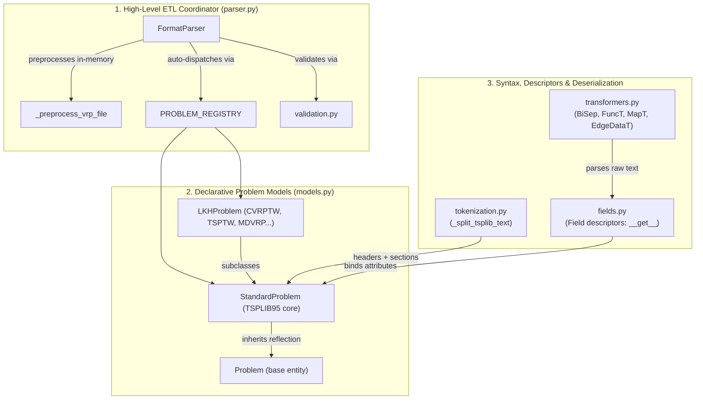
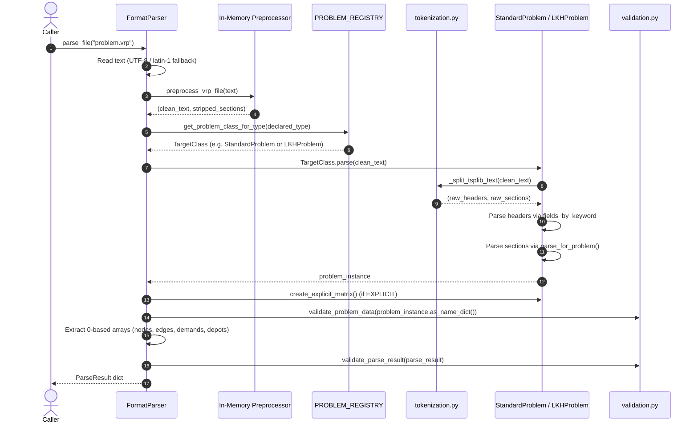

# `tsplib_parser` — High-Performance Routing Data Parser

`tsplib_parser` is a standalone, robust parser and domain model library for vehicle routing problem specifications (TSPLIB95, CVRPLIB, and LKH-3 extended formats). It provides both high-level ETL extraction and low-level declarative AST modeling with zero disk I/O side effects.

---

## 1. The Three-Layer Design Ladder

The parser is structured into three decoupled layers:



### Layer 1: High-Level ETL Coordinator (`parser.py`)

- **Primary Class**: `FormatParser`
- **Responsibility**: Production ETL entry point. Ingests raw problem files or text streams, normalizes encodings (UTF-8 with latin-1 fallback), executes in-memory VRP header preprocessing, resolves problem classes via declarative auto-dispatch, constructs explicit weight matrices, and applies semantic two-stage validation (`validate_problem_data` and `validate_parse_result`).
- **Output**: Canonical 0-based `ParseResult` dictionary ready for Parquet/DuckDB storage.

### Layer 2: Declarative Problem Models (`models.py`)

- **Key Classes**: `Problem`, `StandardProblem`, `LKHProblem`, `PROBLEM_REGISTRY`
- **Responsibility**: Pure domain models representing parsed problem specifications.
  + `Problem`: Abstract metadata entity providing field mapping reflection via `FileMeta` metaclass, dictionary exports (`as_name_dict()`), and attribute access. Does **not** advertise parsing methods (preserving Liskov Substitution Principle).
  + `StandardProblem`: Concrete TSPLIB95 format parser and schema descriptor container (`NAME`, `TYPE`, `DIMENSION`, `EDGE_WEIGHT_SECTION`, etc.).
  + `LKHProblem`: Polymorphic subclass registering extended LKH-3 headers (`VEHICLES`, `DISTANCE`, `SERVICE_TIME`) and sections (`TIME_WINDOW_SECTION`, `PICKUP_AND_DELIVERY_SECTION`, `BACKHAUL_SECTION`).
  + `PROBLEM_REGISTRY`: Dynamic registry mapping problem type keywords (`TSP`, `CVRP`, `CVRPTW`, `MDVRP`) to their model classes.

### Layer 3: Syntax, Descriptors & Deserialization (`tokenization.py`, `fields.py`, `transformers.py`)

- **`tokenization.py`**: Stream splitting without intermediate regexes. Decouples line scanning into `(raw_headers, raw_sections)`, ensuring all header keywords are populated before section evaluation.
- **`fields.py`**: Schema descriptors (`Field`, `TransformerField`, `StringField`, `IntegerField`, `IndexedCoordinatesField`, `MatrixField`, `EdgeDataField`, `ToursField`). Implements python's standard non-data descriptor protocol (`__get__`), resolving defaults on unset fields and accessing `instance.__dict__` at native C speed with zero `__getattribute__` overhead.
- **`transformers.py`**: Reusable text deserializers converting scalar and matrix text into strongly-typed primitives (`BiSep`, `FuncT`, `NumberT`, `EdgeDataT`, `ContainerT`, `ListT`, `MapT`).

---

## 2. Module Inventory

| Module | Lines | Primary Responsibility | Key Classes / Functions |
| :--- | :--- | :--- | :--- |
| [`parser.py`](file:///home/lucas_galdino/chimera/routing_data/src/tsplib_parser/parser.py) | 539 | High-level ETL coordinator and extractor | `FormatParser`, `_preprocess_vrp_file` |
| [`models.py`](file:///home/lucas_galdino/chimera/routing_data/src/tsplib_parser/models.py) | 314 | Domain models and problem registry | `Problem`, `StandardProblem`, `LKHProblem`, `register_problem_class` |
| [`fields.py`](file:///home/lucas_galdino/chimera/routing_data/src/tsplib_parser/fields.py) | 253 | Schema descriptor protocol implementations | `Field`, `TransformerField`, `IndexedCoordinatesField`, `MatrixField` |
| [`transformers.py`](file:///home/lucas_galdino/chimera/routing_data/src/tsplib_parser/transformers.py) | 388 | Pure text deserialization primitives | `BiSep`, `FuncT`, `NumberT`, `EdgeDataT`, `ListT`, `MapT` |
| [`tokenization.py`](file:///home/lucas_galdino/chimera/routing_data/src/tsplib_parser/tokenization.py) | 99 | Lexical line and section stream splitting | `_split_tsplib_text`, `_looks_like_keyword_header` |
| [`validation.py`](file:///home/lucas_galdino/chimera/routing_data/src/tsplib_parser/validation.py) | 616 | Semantic boundary & consistency checks | `validate_problem_data`, `validate_parse_result`, `check_symmetry` |
| [`matrix.py`](file:///home/lucas_galdino/chimera/routing_data/src/tsplib_parser/matrix.py) | 390 | Explicit edge weight matrix reconstructions | `Matrix`, `FullMatrix`, `LowerDiagRow`, `UpperRow` |
| [`types.py`](file:///home/lucas_galdino/chimera/routing_data/src/tsplib_parser/types.py) | 272 | Single source of truth for vocabularies | `VALID_PROBLEM_TYPES`, `SECTION_GRAMMARS`, `NO_DIAG_FORMAT_FALLBACK` |
| [`exceptions.py`](file:///home/lucas_galdino/chimera/routing_data/src/tsplib_parser/exceptions.py) | 120 | Standardized exception hierarchy | `FormatError`, `ParseError`, `ValidationError` |
| [`cordeau/`](file:///home/lucas_galdino/chimera/routing_data/src/tsplib_parser/cordeau) | ~600 | Specialized Cordeau MDVRP parser/converter | `CordeauParser`, `CordeauConverter`, `CordeauProblem` |

---

## 3. Parse Flow Sequence



---

## 4. Usage Examples

### Recommended: High-Level ETL API (`FormatParser`)

```python
import logging
from tsplib_parser.parser import FormatParser

logger = logging.getLogger("etl")
parser = FormatParser(logger=logger)

# Parses any .tsp, .vrp, .sop, .atsp, or .hcp file with full validation:
result = parser.parse_file("datasets_raw/problems/tsp/gr17.tsp")

print(result["problem_data"]["name"])        # 'gr17'
print(result["problem_data"]["dimension"])   # 17
print(len(result["nodes"]))                 # 17
print(result["matrix"].shape)               # (17, 17)
```

### Advanced: Low-Level Declarative AST Model

```python
from tsplib_parser.models import StandardProblem, LKHProblem

raw_text = """
NAME: toy
TYPE: TSP
DIMENSION: 3
EDGE_WEIGHT_TYPE: EUC_2D
NODE_COORD_SECTION
1 10.0 20.0
2 30.0 40.0
3 50.0 60.0
EOF
"""

# Parse directly into the typed model
problem = StandardProblem.parse(raw_text)

# Access fields via descriptor protocol
print(problem.dimension)    # 3 (int)
print(problem.node_coords)  # {1: [10.0, 20.0], 2: [30.0, 40.0], 3: [50.0, 60.0]}

# Export non-default fields as dictionary
data = problem.as_name_dict()
```

---

## 5. Verification & Conformance Status

- **Standard Benchmark Corpus**: **239/239 files (100%)** in `datasets_raw/problems/` parse and pass bidirectional declared-vs-extracted validation with zero errors.
- **Cordeau MDVRP Corpus**: **33/33 files (100%)** in `datasets_raw/umalaga/mdvrp/C-mdvrp/` parse via `CordeauParser` into `CordeauProblem(Problem)`, convert to lossless LKH-3 format via `CordeauConverter.to_tsplib()`, and parse into `LKHProblem`.
- **Fast Test Suite**: **90 passed in 0.25s** (`pytest tests/tsplib_parser -m "not slow and not requires_dataset"`).
- **Code Style & Linting**: 100% compliant with `ruff check` (zero lint or formatting errors).
